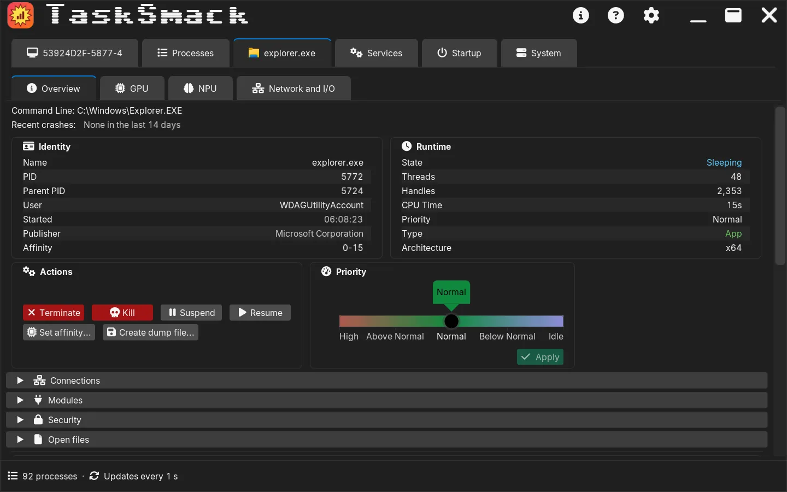
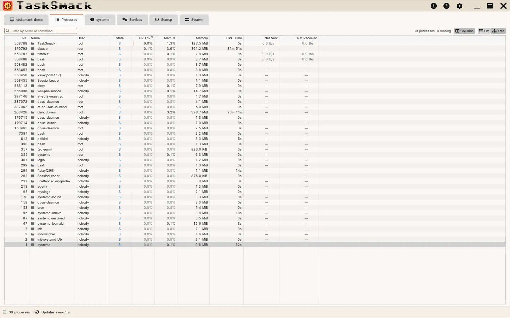

# TaskSmack

TaskSmack is a C++23 system monitor and task manager for Linux and Windows, built with Dear ImGui, ImPlot, SDL3, and OpenGL.

*The machine tab's Overview on Windows, in the Windows Dark theme.*

*The same Overview on Linux, live: every chart advances one sample at the update interval.*

## Highlights

- Sortable, filterable process table with tree view, multi-select, configurable columns, and process details (environment, connections, modules, open files, security context)
- CPU, memory, swap, storage, network, GPU, NPU, and battery histories
- Per-process CPU, memory, disk I/O, network, GPU, and NPU metrics when the platform exposes them
- Process termination, forced termination, priority and CPU affinity changes, suspend/resume, dump files, batch actions on several processes, and Linux I/O priority (ionice) and strace actions
- Services and Startup (Windows) tabs that list and control services and startup apps, and a System tab of hardware, firmware, network, driver, and crash facts
- TOML configuration, 20 bundled themes, user themes, configurable sampling, and bounded history
- Capability-driven UI that hides unavailable metrics instead of fabricating cross-platform parity

See [Implemented Features](docs/dev/completed-features.md) for the detailed shipped-feature inventory.

## Screenshots

| The Processes tab (Windows) | Process Details (Windows) |
|---|---|
|  |  |
| **The Processes tab (Linux, Ubuntu Light theme)** | **The System tab (Windows)** |
|  |  |

The [User Guide](docs/guide/user-guide.md#feature-overview) has a screenshot of every tab, the Process Details sections, and the [theme gallery](docs/guide/user-guide.md#themes-and-configuration).

## Supported Platforms

| Platform | Support |
|----------|---------|
| Linux, kernel 5.10 or later | Supported |
| Windows 10 version 1903 or later | Supported |
| macOS and other operating systems | Not supported |

Linux 5.10 is the first kernel that lets the privileged helper set the Realtime I/O class with only `CAP_SYS_NICE`; every current distribution ships it or newer (Debian 11, Ubuntu 22.04, RHEL 9, and later). The prebuilt Linux packages also need glibc 2.38 or newer (Ubuntu 24.04, Debian 13, Fedora 39, RHEL 10, or later); on an older distribution, build from source. See the [User Guide](docs/guide/user-guide.md#operating-system).

Windows 10 version 1903 is the first release that honours the application manifest's UTF-8 process code page (`activeCodePage`), which TaskSmack relies on for UTF-8 text throughout.

Some metrics require optional drivers, vendor libraries, kernel support, or elevated privileges. The [User Guide](docs/guide/user-guide.md) documents those differences.

## Download

**[Latest release](https://github.com/mgradwohl/tasksmack/releases/latest)**

| Platform | Package | Install |
|----------|---------|---------|
| Debian/Ubuntu | `.deb` | `sudo apt install ./TaskSmack-*.deb`, then run `TaskSmack` (installs to `/usr/bin`) |
| Other Linux distributions | `.tar.gz` | Extract and run `bin/TaskSmack` |
| Windows | `.zip` | Extract and run `TaskSmack.exe` (no Visual C++ Redistributable needed) |

The Linux packages need glibc 2.38 or newer (Ubuntu 24.04, Debian 13, Fedora 39, RHEL 10, or later); on Ubuntu 22.04, Debian 12, RHEL 9 or another older distribution, [build from source](CONTRIBUTING.md#quick-start).

Each package comes for x64 and ARM64. The x64 files are `TaskSmack-<version>-Linux.deb`, `-Linux.tar.gz` and `-win64.zip`; the ARM64 ones are `TaskSmack-<version>-linux-aarch64.deb`, `-linux-aarch64.tar.gz` and `-windows-arm64.zip` (Windows on Arm, such as Snapdragon X PCs).

On Linux, the `.deb` also installs a small privileged helper and its polkit action, which let TaskSmack act on or read another user's process after asking for an administrator's password (**Authenticate and retry**, **Authenticate to read**); the `.tar.gz` doesn't include them. See the [FAQ](docs/guide/faq.md#process-io-fds-or-network-show-na-on-linux). On Windows, the Authenticode-signed `.zip`s (x64 and ARM64, from v0.9.1) carry `TaskSmackHelper.exe` for the same purpose (**Retry as administrator**); see [Acting as an administrator on Windows](docs/guide/faq.md#acting-as-an-administrator-on-windows).

Published x64 packages are built with default compiler optimizations and run on any x86-64 CPU (no AVX2 required). Building from source lets you target a different microarchitecture; see the [User Guide](docs/guide/user-guide.md#system-requirements).

Every release asset is signed with Sigstore; see [Verifying a Release](docs/guide/user-guide.md#verifying-a-release) for how to check one before installing it.

From v0.9.1, the Windows release executables are Authenticode-signed through Azure Artifact Signing, with **Matt Gradwohl** as the publisher ([#2302](https://github.com/mgradwohl/tasksmack/issues/2302)); see the [Code signing policy](docs/code-signing-policy.md).

## Building from Source

To build TaskSmack yourself on Linux or Windows, follow the [Quick Start](CONTRIBUTING.md#quick-start) in CONTRIBUTING.md. It covers cloning, the automated setup scripts that install every prerequisite, and the one-command build-and-test workflow.

## Documentation

| Document | Scope |
|----------|-------|
| [User Guide](docs/guide/user-guide.md) | Installation, usage, platform differences, and configuration |
| [FAQ](docs/guide/faq.md) | Troubleshooting and capability limitations |
| [Implemented Features](docs/dev/completed-features.md) | Canonical shipped-feature inventory |
| [Contributing](CONTRIBUTING.md) | Canonical setup, build, test, tooling, and contribution workflow |
| [Architecture](tasksmack.md) | Canonical layer boundaries, sampling pipeline, and engineering direction |
| [Security Policy](SECURITY.md) | Private vulnerability reporting |
| [Code of Conduct](CODE_OF_CONDUCT.md) | Contributor conduct policy and reporting path |
| [Documentation site](https://mgradwohl.github.io/tasksmack/) | Web navigation for the same documentation |

`CHANGELOG.md` is generated by git-cliff (the Changelog workflow) when a release tag is pushed; don't edit it by hand.

## Questions and Discussion

Ask questions in [Discussions Q&A](https://github.com/mgradwohl/tasksmack/discussions/categories/q-a), share ideas in [Ideas](https://github.com/mgradwohl/tasksmack/discussions/categories/ideas), and show your setup in [Show and tell](https://github.com/mgradwohl/tasksmack/discussions/categories/show-and-tell). Issues are for bugs and planned work: use the [bug report](https://github.com/mgradwohl/tasksmack/issues/new?template=bug_report.md) or [feature request](https://github.com/mgradwohl/tasksmack/issues/new?template=feature_request.md) template.

## License

[MIT](LICENSE)
