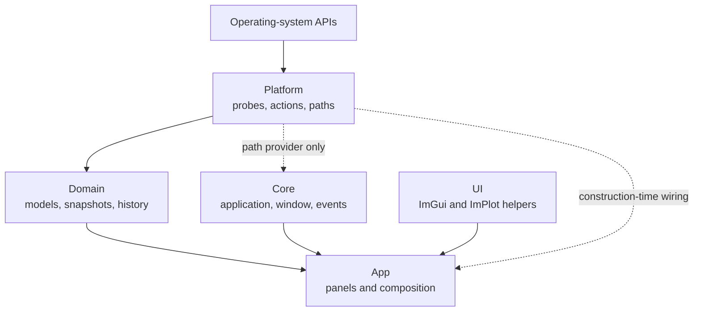

# TaskSmack Architecture

This document is the canonical description of TaskSmack's architecture and current engineering direction. User-facing behavior belongs in the [User Guide](docs/guide/user-guide.md), shipped features in [completed-features.md](docs/dev/completed-features.md), and developer commands in [CONTRIBUTING.md](CONTRIBUTING.md).

## Design Goals

- Keep operating-system access isolated and capability-aware.
- Derive rates and percentages from raw counters in testable domain models.
- Publish stable snapshots that UI code can render without touching platform APIs.
- Keep expensive process and GPU collection off the render path.
- Bound history and cache growth during long-running sessions.
- Preserve a single application target without sacrificing module boundaries.

## Layer Model

- Platform probes read raw OS counters and never compute deltas or rates. They may keep implementation state that serves those reads: caches of raw readings and the bookkeeping a raw reading needs. On Linux, `LinuxProcessProbe` keeps a UID-to-username cache (one entry per UID seen, never evicted); each process's command line, keyed by PID, start time and comm, re-read within `PROCESS_CMDLINE_CACHE_TTL_MS` and dropped once the process is no longer listed; the socket inode-to-PID map, which `enumerate()` rebuilds every `INODE_PID_CACHE_TTL_MS` from the same `/proc/[pid]/fd` walk that counts FDs; the TCP socket query result, cached for `socket_stats_cache_ttl_ms` (default `SOCKET_STATS_CACHE_TTL_MS_DEFAULT`); and, for socket attribution, when each still-unowned socket was first seen (replaced by every reading).
- Process enumeration and each system-metrics domain (System, Storage, GPU/NPU) run on their own `BackgroundSampler` threads (each seeded on its thread by its start hook), so the UI stays responsive under heavy load and a stalled source (a disk rescan, a GPU enumeration) never delays another domain's samples (#2731). The Services and Startup tabs have their own samplers, which run only once their tab has been shown.
- Domain code transforms counters into snapshots and maintains history.
- UI (panels) consumes snapshots, renders views through ImGui/ImPlot, and never calls platform APIs directly.
- OpenGL usage is confined to Core/UI (SDL3 + ImGui backends).
- CPU percentage uses process CPU delta divided by total system CPU delta.
- Disk I/O and page-fault rates use consecutive sample deltas.
- Per-process network rates use deltas between consecutive network readings. Where a probe reports raw per-connection byte counters (Linux), `ProcessModel` accumulates each connection's growth into monotonic per-process counters, so a connection closing doesn't make a rate drop and a connection attributed late never delivers its lifetime bytes as a spike. The growth a connection shows before it is attributed is held and credited to its owner once it is, so that recent growth (at most `UNATTRIBUTED_SOCKET_HOLD_MS` of it; a hold that outlasts the deadline is dropped) can still be concentrated into the interval in which the connection is attributed, and the Linux probe rebuilds its inode-to-PID map early (rate-limited by `INODE_PID_CACHE_EARLY_REBUILD_MS`) when a socket appears unowned after the last rebuild. A connection is credited to its owner by PID and start time when both are known, so a process that reuses a PID gets none of the old owner's traffic. That protection needs the owner's start time: the Linux probe reports it (unless its `stat` read fails), Windows reports none, and a connection whose owner start time is unknown is matched by PID alone.
- System and interface network rates use consecutive sample deltas.
- GPU data is merged into process snapshots when the platform can attribute usage.

The diagram shows runtime data flow. Compile-time dependencies are constrained more tightly: Domain depends on Platform interfaces, App is the composition root, and UI never depends on Platform.

### `src/Platform`

- Declares probe and action interfaces.
- Implements Linux and Windows access to process, system, disk, GPU, power, networking, and path APIs.
- Returns cumulative counters and capability flags rather than UI-ready rates.
- Contains no Core, UI, or App dependencies. From Domain it uses only header-only constants and helpers (`SamplingConfig.h`, `PriorityConfig.h`, `Numeric.h`).

### `src/Domain`

- Owns `ProcessModel`, `SystemModel`, `StorageModel`, `GPUModel`, immutable snapshots, and bounded history.
- Converts cumulative counters into deltas, percentages, and rates.
- Handles counter rollback, PID reuse, sanity limits, and history retention.
- Depends only on Platform interfaces, the C++ standard library and spdlog.

### `src/Core`

- Owns application startup, the main loop, the SDL3 window, events, and shutdown.
- Owns `PathService`, the only caller of `Platform::makePathProvider()`.
- Confines window-system and OpenGL context work to Core/UI boundaries.

### `src/UI`

- Owns Dear ImGui and ImPlot integration, themes, icons, shared widgets, charts, and formatting.
- All history charts render through the shared `HistoryChart` RAII helper (`ChartWidgets.h`), which applies the chart font, legend, time axis, Y-axis formatter, and locked-vs-auto-fit Y policy in one place.
- `RenderMetrics` captures per-chart vertex counts and CPU time when the Render Metrics overlay (Ctrl+Shift+M) is open; recording is a no-op branch otherwise. Without input, `TASKSMACK_RENDER_METRICS=<file.csv>` shows the overlay from the first frame and writes its CSV at exit, and `TASKSMACK_DEMO`'s `metrics=<on|off|export>` steps drive it mid-run (#2923, `App/RenderMetricsOverride.h`). Per-chart indices are deliberately not captured (see #908); the overlay's frame-level total still reports ImGui's own index count.
- May consume Domain snapshots and Core path services.
- Never creates probes or calls operating-system APIs.

### `src/App`

- Owns the shell, settings, title bar, panels, and user configuration.
- Creates Platform probes and actions in `App/PanelPlatforms.cpp` (and `App/SyntheticScenario.cpp` for synthetic runs) and injects them into Domain models.
- Coordinates sampling cadence, snapshot caching, selection, and rendering.
- Is the only general composition root for `Platform::make*Probe()` and process-action factories.

`src/Training` holds `TaskSmackUiTraining`, the headless UI driver that the PGO presets use to train a profile (#880). It reuses the application's objects and adds no layer of its own.

## Dependency Rules

| From | Allowed dependencies |
|------|----------------------|
| Platform | OS APIs and standard/third-party utility libraries |
| Domain | Platform interfaces |
| Core | Domain; Platform path provider through `PathService`, and Platform's header-only string and thread-name utilities; SDL3/OpenGL |
| UI | Domain; Core path access; ImGui/ImPlot/OpenGL |
| App | Platform factories, Domain, Core, and UI |

Hard rules:

- Platform probes return raw counters; Domain computes rates and percentages.
- Domain never includes Platform implementations or calls Platform factories.
- `Platform::makePathProvider()` is called only by `Core::PathService`.
- Only `App/PanelPlatforms.cpp`, `App/SyntheticScenario.cpp`, `Core/PathService` and `main.cpp` include `Platform/Factory.h`.
- OpenGL calls remain in Core and UI.

## Sampling and Publication

Sampling is deliberately mixed according to workload:

1. `ProcessesPanel::onAttach()` creates `ProcessModel` without a probe (`Domain::DEFERRED_PROBE`), adds it to a `BackgroundSampler` (`ts-sampler-proc`) and starts it. The sampler's start hook (`SamplerConfig::onThreadStart`, #2731), on the sampler thread, gets the platform from `App/PanelPlatforms` (probe, actions, icons, UDP collector), hands the probe to the model (`setProbe()`), performs the seed read, and leaves the UI-owned parts (actions, icons, collector) in a handoff the panel adopts on its next frame.
2. `SystemMetricsPanel::onAttach()` creates System, Storage, and GPU models the same way and starts a `BackgroundSampler` for each (#2731): `ts-sampler-sys` (CPU, memory, network, power), `ts-sampler-disk` (the disk counters and their `PdhEnumObjects` rescans) and `ts-sampler-gpu` (DXGI, NVML and their rescans). Each sampler's start hook builds its own probe(s) through `App/PanelPlatforms` (`makeSystemModelProbes()`, `makeStorageModelProbe()`, `makeGPUModelProbe()`), sets them and seeds its model, so a DXGI/NVML enumeration or a disk rescan that stalls on a driver or PnP event holds up its own thread only, never the CPU and memory samples; each model publishes with its own sample timestamp, so the charts need no lockstep. System work can't delay process enumeration, and the four samplers fail independently. All three of the panel's samplers run at the Settings interval (`setSamplingInterval()` sets all three; `samplerIntervals()` reports them); device rescans keep their fixed constants (`GPU_RESCAN_INTERVAL_SECONDS` in `SamplingConfig.h`; the Windows disk probe's `DISK_REENUMERATE_INTERVAL`).
3. Each `BackgroundSampler` uses `std::jthread`, `std::stop_token`, and a condition variable to call `sample()` at the configured interval and wake immediately for refresh, interval, or stop requests. On Windows the panels' sampler threads enter the multithreaded COM apartment for their life (`SamplerConfig::multiThreadedApartment`, `Platform::MultiThreadedApartment`), so the COM objects the probes create (PDH's providers, DXGI) never marshal through the UI thread's STA. PDH is used from three threads (the system probe's CPU-frequency query, the disk probe's object-list refresh, the System Information thermal read): each holds its own query handle, PDH serializes its process-wide object list internally, and `Platform::Windows::keepComForPerfProviders()` is once-per-process and once-per-thread state, so no shared cache needs a lock of its own. `onAttach()` therefore returns without a probe call or a read. Until the seed is adopted (`onUpdate()`), a publication is the empty generation: the charts draw no data, the Processes table no rows, `hostname()` is "System" (the shell relabels the tab when the hostname arrives) and `processCapabilities()` the defaults (the column defaults and the startup privilege notice wait for the first generation). Tests that need the seed in place call `waitForFirstSample()`.
4. Domain models compute deltas under a sampling lock, producing snapshots keyed by PID/time and updating histories.
5. System, Storage, and GPU models atomically publish immutable versioned snapshot-and-history generations; ProcessModel publishes a monotonic snapshot version.
   - GPU data has one owner, the GPU model on its own sampler (`ts-sampler-gpu`; #1417, #2731): each refresh reads the system and the per-process GPU counters together and publishes the per-process ones, stamped with the refresh time. `ProcessModel` merges the newest of those publications (`ShellPanels::connectModels()` hands it the GPU model) and never calls the GPU probe, so a slow driver read can't delay the process list. The two samplers keep their own cadences: one publication can be merged into several process generations, its per-process utilization being a rate over one GPU interval; one older than `PROCESS_GPU_DATA_MAX_AGE_MS` (the GPU sampler has stalled) is shown as a failed read; a process first listed after the read shows as not read yet, even if the read has an entry for its PID (that entry belongs to an exited process that held the PID).
6. Panels retain those generations and rebuild process filter/sort caches only when versions change, avoiding render-frame locks and deep copies.
7. Process Details records history once per ProcessModel publication rather than once per UI timer tick, so the frame rate can neither duplicate a stale value nor drop one. `ProcessModel::watchProcess()` keeps a shared sample of the selected process from every publication (the last 64), each stamped with the time the generation was sampled; the details pane takes in every sample newer than its last, so generations published between two frames are not lost and its charts share the Overview's timebase. A frame with nothing new costs one atomic load and copies no snapshot.

The default interval is 1 second and can be configured from 100 ms to 5 seconds. History defaults to 5 minutes and is bounded from 10 seconds to 30 minutes. Shared defaults and clamps live in `src/Domain/SamplingConfig.h`.

Sampling and drawing are separate (#2731): every sampler runs at the refresh interval set in Settings, in every UI state. A hidden tab, a resize or move, a minimized window and the frame rate change what is drawn and how often, never how often the data is sampled. `ProcessesPanel::samplingInterval()`, `SystemMetricsPanel::samplingInterval()` and `SystemMetricsPanel::samplerIntervals()` (all three of that panel's samplers) expose the samplers' intervals, and the panel tests check each equals the setting through every state.

Timer inventory (the threads that do timed work, and what sets each period): `ts-sampler-proc` (processes), `ts-sampler-sys` (CPU, memory, network, power), `ts-sampler-disk` (disks), `ts-sampler-gpu` (GPUs and NPUs) and `ts-sampler-sens` (sensors) run at the Settings interval; the GPU and disk rescans and the battery facts (`ts-battery-read`) run at their constants in `SamplingConfig.h`; `ts-sampler-svc` and `ts-sampler-auto` run at constants only while wanted; the Process Details and System Information readers run on demand at their own constants. The UI thread times nothing but its own redraw.

### History Storage

History rings are sized from the configured window by `Sampling::historyCapacityForSeconds()`, so the whole window fits even at the fastest refresh, and are trimmed by time in O(1) on every sample; all the series in one model share one timestamp axis and are trimmed together.

`SystemModel` keeps its history in `Domain::SharedHistoryBuffer` (`src/Domain/SharedHistory.h`): append-only blocks whose slots are written once and never again, so a publication holds `Domain::HistoryView`s of them -- contiguous, immutable, converting to `std::span` -- instead of copies, and a publish is O(series) whatever the history length (#1412). Each sample's history append is a transaction with the strong guarantee: `stageHistoryAppend()` makes every allocation first -- new core slots and new interfaces' Rx/Tx series built and backfilled off to the side, their last-seen entries, `reserve()` on every existing series, vector capacity and hash buckets -- then the `noexcept` `commitHistoryAppend()` splices the staged nodes in and pushes to every series without allocating, and the snapshot is moved in last. A `std::bad_alloc` therefore leaves every series aligned and the model unchanged (a failure in `publish()` after the commit leaves the history one sample ahead of an unchanged publication); `tests/Domain/test_SystemModelAllocationFailure.cpp` fails each allocation of such a sample in turn. `GPUModel` does the same per GPU (#1412, slice 3): each GPU's 11 published series are `SharedHistoryBuffer`s appended per sample (no `GPUSnapshot` history), `stageHistoryAppend()` builds a GPU new to a read off to the side and reserves every existing series and the map's buckets, and the `noexcept` `commitHistoryAppend()` splices it in and appends a sample or a placeholder (#1146) to every GPU; `tests/Domain/test_GPUModelAllocationFailure.cpp` covers a refresh that adds a GPU. `StorageModel` does the same (#1412 slice 2): its timestamps, totals and per-disk series are shared buffers, and `applySample()` copies the per-disk rate state and stages a new disk's backfilled series before the `noexcept` commit swaps and splices them in (`tests/Domain/test_StorageModelAllocationFailure.cpp`). `ProcessModel`'s five aggregated system histories (timestamps, power, page faults, threads, handles) are `SharedHistoryBuffer`s too (#2156): `tryCopySystemHistoriesIfNewer()` hands out `HistoryView`s rather than copies, `appendSystemHistoryLocked()` reserves all five before pushing to any, and a failed append in a refresh drops that one history sample but still publishes the process list (`tests/Domain/test_ProcessModelAllocationFailure.cpp`). The allocation-failure tests share the binary's one `operator new` replacement, `tests/Domain/AllocationFailureHook.{h,cpp}` (`TestSupport::FailAllocationAfter`; compiled out, and the tests skipped, where `TASKSMACK_NO_ALLOCATOR_HOOK` is defined: Windows and sanitizer builds).

### Process Identity and Rates

Process state is keyed by PID plus start time so PID reuse creates a fresh baseline. Domain models guard against counter rollback and implausible rates.

A per-process value the probe could not read (on Linux, for another user's process: its FD count without `CAP_DAC_READ_SEARCH`, which lists `/proc/[pid]/fd`; its I/O and network attribution without `CAP_SYS_PTRACE` as well, which `/proc/[pid]/io` and the fd links need -- root has both unless they are dropped) is flagged unavailable in `ProcessCounters`/`ProcessSnapshot` (`handleCountAvailable`, `ioAvailable`, `networkAvailable`). A rate needs both readings it is taken between. Unavailable values are shown as N/A and as gaps in the charts, and they are left out of the system totals rather than counted as 0.

## Composition Root and Allowed Dependency Matrix

App serves as the **composition root**: it is the only place where Platform probes are
instantiated and injected into Domain models. This is intentional and correct—only App panels
have enough context to pair the right Platform implementation with the right Domain model.

The key distinction is **construction-time wiring** (allowed in App panels) vs **runtime calls**
(which must respect the layering rules):

| Layer | May call at construction / `onAttach` | May call at runtime |
|---|---|---|
| Platform | OS APIs | OS APIs |
| Domain | *(none — receives probes via constructor, or via `setProbe()` from the sampler's start hook, #2731)* | injected probe interface methods (e.g. `enumerate()`, `totalCpuTime()`); never `Platform::make*()` factories |
| Core | `Platform::makePathProvider()` via `PathService` | `PathService`, SDL3, OpenGL |
| App / Panels | `Platform::make*Probe()`, `Platform::makeProcessActions()` | Core, Domain snapshots, UI widgets |
| UI | *(none)* | ImGui, ImPlot, `Core::Application::get().paths()` |

**Rules derived from the matrix:**

- `Platform::makePathProvider()` is called **only** inside `Core::PathService` (owned by `Application`).
  All path resolution elsewhere goes through `Core::Application::get().paths()`.
- `Platform::make*Probe()` and `Platform::makeProcessActions()` are called **only** in `App/PanelPlatforms.cpp`
  (and `App/SyntheticScenario.cpp`), which panels call at attach time -- from their sampler's start hook, on
  the sampler thread (#2731) -- never from UI rendering code or Domain.
- No new `#include "Platform/Factory.h"` should appear in `UI/` or in `App/` outside those two files.

## UI Layer Model

- **ShellLayer:** main tabs, global settings (refresh cadence, theme, column visibility), shared selection state. A `PanelTabs` registry binds each shell-owned panel to its event name and cached-label provider in one constructor list. The registry owns its event-name strings and provider callables, but references panels without owning them; panels and objects referenced by provider captures must outlive the registry. The first registration is the default tab; registration order drives tab display, attach, update, and event forwarding, with reverse-order detach. `Panel::renderContent()` renders the selected tab without a window wrapper. Cross-panel model sharing and selected-process snapshot updates remain explicit shell coordination.
- **ProcessesPanel:** process list with sorting and details selection.
- **ProcessDetailsPanel:** detailed view for the currently selected process.
- **SystemMetricsPanel:** the machine's tab: plots and timelines backed by domain history.
- **ServicesPanel:** Windows services or systemd units, with their own sampler (`ts-sampler-svc`) once the tab is shown.
- **StartupPanel:** Windows startup apps, with their own sampler (`ts-sampler-auto`) while the tab is shown.
- **SystemInfoPanel:** System Information, read on demand off the UI thread.

## Process Scalability

To keep the UI responsive with thousands of processes, TaskSmack applies the following constraints:
- **Stable Identity**: Uses a stable cache keyed by PID + start time to cleanly cope with PID reuse.
- **Background Tree Building**: Hierarchical process trees are built in the Domain layer during background sampling (`ProcessModel`), not on the UI thread. The `ProcessSnapshot` natively carries pre-computed `childrenIndices`. Parent/child links additionally require the candidate parent's start time to be at or before the child's, so a PID recycled to an unrelated process between the two `/proc` reads that produced a sample can't be mistaken for the real parent.
- **Cached Filtering/Sorting**: Filtering and sorting indices are cached and only rebuilt when the data version or filter string changes, keeping the per-frame render loop strictly $O(V)$ where $V$ is the number of visible rows.

## OpenGL + SDL3 Integration Details

- SDL3 handles window creation, input, DPI, framebuffer scaling, and multi-viewport support.
- OpenGL core profile (3.3+); only the renderer and ImGui backend issue GL calls.
- GLAD provides the OpenGL function loader (generated at build time via Python + jinja2).
- ImGui integrations: `imgui_impl_sdl3` for events and `imgui_impl_opengl3` for rendering.
- SDL3 events are polled each frame; input is handled via ImGui input state.

### Capability Reporting

Probe capabilities describe whether fields such as I/O, command line, user, priority, network, GPU, and process status are available. Panels use those flags to hide unsupported columns and actions. Reduced-privilege detection can surface an elevation notice when elevation would restore data.

Some per-process data is read on demand rather than in the per-sample enumeration. A process's environment variables (#179) are read through `Platform::IProcessEnvironmentReader` (`makeProcessEnvironmentReader()`, made in `App/PanelPlatforms`; `hasEnvironment()` is its capability flag, false in synthetic runs), only for the selected process, only while the Overview's Environment section is open, from the panel's update path (never `render()`), at most every `PROCESS_ENVIRONMENT_REFRESH_MS`. The read runs on a worker thread, one at a time (`LazyBackgroundRead`, `ts-env-read`), because reading `/proc/<pid>/environ` can block on a hung mount (#2116). On Linux the reader is `LinuxProcessEnvironmentReader` (`/proc/[pid]/environ` through a handle on `/proc/[pid]`, after the start-time check). On Windows (#2569) `WindowsProcessEnvironmentReader` opens the process with `PROCESS_QUERY_LIMITED_INFORMATION | PROCESS_VM_READ`, checks its creation time (`openProcessVerified()`), asks `NtQueryInformationProcess(ProcessBasicInformation)` for its PEB and reads `PEB::ProcessParameters`, then `RTL_USER_PROCESS_PARAMETERS::Environment` and `EnvironmentSize`, then the UTF-16 block itself with `ReadProcessMemory`, a page at a time, stopping at the block's double NUL, at `EnvironmentSize`, or at a 1 MiB cap (and keeping at most 4096 variables; past either the result says truncated); the block is converted to UTF-8 and parsed as the Linux one is (`Platform::Environment::parseEnvironBlock()`), so a `=C:=C:\dir` drive entry keeps its leading `=`. The layouts read are the build's own pointer size, so a 32-bit (WOW64) process seen from the 64-bit build reads as `Failed` with that reason (`EnvironmentReadResult::detail`); reading its 32-bit PEB (`ProcessWow64Information`) and reading as an administrator through the helper (#2517) are later steps. Values are never logged.

A process's TCP and UDP connections (#799) are read the same way through `Platform::IProcessConnectionsReader` (`makeProcessConnectionsReader()`, `hasConnections()`; unsupported in synthetic runs), while the Overview's Connections section is open, at most every `PROCESS_CONNECTIONS_REFRESH_MS`. Like the environment read it runs on a worker thread (`LazyBackgroundRead`, one read at a time; a result for a previous selection is dropped), since a netlink receive may wait up to its 2 s `SO_RCVTIMEO`, and a netlink socket whose timeout cannot be set is not used. On Linux the reader takes the process's socket inodes from `/proc/[pid]/fd` (through one `/proc/[pid]` handle, after the start-time check) and matches them against an `INET_DIAG` dump of every TCP/UDP, IPv4/IPv6 socket (`dumpInetSockets()` in `NetlinkSocketStats`, sharing its dump loop but with its own netlink socket, opened on first use), falling back per table to `/proc/[pid]/net/{tcp,tcp6,udp,udp6}` when netlink can't dump it or the process is in another network namespace. On Windows (#1489) `WindowsProcessConnectionsReader` opens the process for limited query, checks its creation time, and with that handle still open (pinning the PID) reads `GetExtendedTcpTable(TCP_TABLE_OWNER_PID_ALL)` and `GetExtendedUdpTable(UDP_TABLE_OWNER_PID)` for IPv4 and IPv6, keeping the target's rows; the tables cover every user, so only a process it cannot open reads as `PermissionDenied`. Platform returns raw rows (network-order address bytes, ports, a neutral state); `Domain/ProcessConnections.h` formats and orders them.

Capability absence is not an error. A supported platform may still omit metrics because of kernel configuration, permissions, hardware, drivers, or optional vendor libraries.

## Platform Strategy

### Linux

| Area | Primary sources |
|------|-----------------|
| Processes and CPU | `/proc/stat`, `/proc/[pid]/stat`, `/proc/[pid]/status`, `/proc/[pid]/io` |
| Memory | `/proc/meminfo`, process `statm`/status data |
| Network | `/proc/net/dev`, Netlink `INET_DIAG`, `/proc/[pid]/fd` ownership mapping |
| Storage | Linux block-device and filesystem interfaces |
| Power | `/sys/class/power_supply` |
| GPU | NVML for NVIDIA, ROCm SMI for AMD, DRM/sysfs for Intel and generic discovery |
| NPU | The kernel's accel subsystem (`AccelNpuProbe`) |
| Process actions | POSIX signals, `setpriority`, `ioprio_set`/`ioprio_get` (read on demand for the selected process), affinity APIs; system call tracing by starting `strace -p` in a terminal emulator (double fork, no shell) |

For other users' processes, per-process I/O and network attribution need `CAP_DAC_READ_SEARCH` plus `CAP_SYS_PTRACE` in the effective set (reading `/proc/[pid]/io` and the `/proc/[pid]/fd/*` links is checked with `PTRACE_MODE_READ_FSCREDS`) — root with its normal capabilities has them, but root alone isn't enough where capabilities are dropped (a container or hardened service); FD counts need only `CAP_DAC_READ_SEARCH` (listing `/proc/[pid]/fd` is a plain permission check). Per-process network attribution requires Linux 4.2+ Netlink support.

The UI never runs as root for this. With the `.deb` (or a locally built `.rpm`) installed, an action or read another user's process refuses for want of permission (and System Information's root-only firmware facts, memory modules and every user's crashes) can go through `tasksmack-helper` (#2307, #2181): a separate executable built from Platform sources only (no SDL, ImGui, GL or config), installed at `/usr/libexec/tasksmack/tasksmack-helper`. `Platform::PkexecBroker` (the Linux `IPrivilegedBroker`, made once by `makePrivilegedBroker()` and only when the helper is installed and TaskSmack isn't already root) starts it with `pkexec` for the polkit action `app.tasksmack.TaskSmack.helper` (`assets/linux/app.tasksmack.TaskSmack.helper.policy`, `auth_admin_keep`) only when the user chooses **Authenticate and retry** or **Authenticate to read**, and talks `BrokerProtocol` to it over an unnamed `SOCK_SEQPACKET` socketpair. The helper checks that its peer is the process that started it and the user pkexec authenticated, then stops being root -- it runs as `nobody` (65534), with no supplementary groups and not dumpable (#2752) -- keeping only `CAP_KILL`, `CAP_SYS_NICE`, `CAP_SYS_PTRACE` and `CAP_DAC_READ_SEARCH`, and sets `no_new_privs` (`HelperPrivileges.h`, #2640), installs a seccomp allow-list (`HelperSandbox.h`, #2752: no file writes or creates, exec, `PROT_EXEC` mappings, ptrace or `process_vm_*`, new sockets or `open_by_handle_at`; a call it doesn't list is logged, or kills the helper under `--seccomp=enforce`, which the tests pass; it looks systemd-coredump's user up and loads libsystemd's decompressors first, reads connections from `/proc/<pid>/net` rather than a netlink socket, and signals by number only itself; refusals are logged too, `SECCOMP_FILTER_FLAG_LOG`), answers only the protocol's closed set of requests (signal, priority, I/O priority, affinity; environment, modules, open files, connections, PSS/USS, FD counts and I/O bytes, firmware files, crashes), and exits when the socket closes or 5 minutes after the last Hello or action. `BrokeredProcessActions` and `BrokeredSystemInfoProbe` wrap the in-process implementations and use the helper only after a permission refusal; background reads only ask a helper that is already running, so they never prompt. Among those, `BrokeredProcessProbe` sends one `ReadProcessCounters` batch per enumeration for the processes whose FD count or `/proc/[pid]/io` was refused (#2728), and the helper answers each from `/proc/[pid]/fd` and `/proc/[pid]/io` after the start-time check (`ProcessCountersRead.h`).

### Windows

| Area | Primary sources |
|------|-----------------|
| Processes and CPU | `NtQuerySystemInformation` and process APIs |
| Memory | Windows memory and process-information APIs |
| Network | interface tables, TCP EStats, and an opt-in ETW kernel network session for UDP (`WindowsEtwNetCollector`) |
| Storage and power | Windows system APIs; per-process power from the Energy Meter Interface (EMI) devices' CPU package channels (`WindowsEnergyMeter`, #2587); System Information's disk health is the NVMe health log through `IOCTL_STORAGE_QUERY_PROPERTY` and, for ATA and SATA drives, SMART READ DATA, READ THRESHOLDS and RETURN STATUS through `IOCTL_ATA_PASS_THROUGH` (#2588; administrators only, since the IOCTL needs a read-write disk handle), parsed by the pure `WindowsStorageSmartMath.h` |
| GPU and NPU | DXGI and DXCore, NVML, PDH, and the kernel graphics adapter's performance data (`D3DKMTQueryAdapterInfo`, `KMTQAITYPE_ADAPTERPERFDATA`) for the temperature, clock and fan of GPUs NVML doesn't cover (#2586) |
| Process actions | `TerminateProcess`, priority classes, affinity APIs, `PssCaptureSnapshot` + `MiniDumpWriteDump` (dump files, #807, #2001), `IFileOpenDialog` (the dump folder, #2001) |

Per-process TCP byte counters use `GetPerTcpConnectionEStats` and require administrator privileges to enable collection. Without them no process's network bytes are read, so each process reports them unavailable (N/A) rather than 0; handle counts and I/O bytes come from the bulk snapshot and are read for every process (#1285). Per-process power (#2587) is the CPU packages' cumulative energy from the Energy Meter Interface devices (`GUID_DEVICE_ENERGY_METER`, `emi.h`): `WindowsEnergyMeter` enumerates them with SetupAPI and opens them once on the probe's one-shot `ts-emi-open` worker (never the UI thread), reads each meter's metadata for its `RAPL_Package<N>_PKG` channels, and polls `IOCTL_EMI_GET_MEASUREMENT` every sample for the raw picowatt-hour counters, converted to microjoules; `Domain::ProcessEnergy::Attributor` shares each interval's energy out by CPU time, exactly as it does Linux's RAPL counter, and the summed per-process power feeds the System tab's Power chart. A machine with no energy meter, or none with a package channel, reports `hasPowerUsage` false and the Power column, Process Details figure and chart stay hidden. Windows does not expose Linux concepts such as load average or CPU steal time. Suspend and Resume, SIGSTOP and SIGCONT on Linux, are ntdll's `NtSuspendProcess`/`NtResumeProcess` on a start-time-checked handle (#2582); PID 4, critical and protected processes, and TaskSmack itself are never suspended.

Process enumeration takes one bulk `NtQuerySystemInformation(SystemProcessInformation)` snapshot per sample, which supplies CPU times, memory, I/O, handle/thread counts, thread states, base priorities, and image names for every process without opening per-process handles. The process state letter is derived from the thread states (R: a thread runs or is ready; T: every thread suspended; S: otherwise; I: the System Idle Process; never Z). Slower-changing details are refreshed through short-lived process handles on RAM-tuned TTLs: status and GDI objects on the light one; owner, command line (`ProcessCommandLineInformation`, else the image path), publisher, affinity, and classification on the heavy one. The priority class is read with the heavy details and again as soon as the snapshot's base priority changes, so a priority change shows on the next sample (#1156).

When TaskSmack isn't running as administrator, an action or read Windows refuses for want of rights can go through `TaskSmackHelper.exe` (#2181), built from Platform sources only. `Platform::PipeBroker`, the Windows twin of `PkexecBroker`, starts it elevated with `ShellExecuteExW("runas")` (`HelperLauncher`) only when the user chooses **Retry as administrator** or **Read as administrator**, and talks the same `BrokerProtocol` to it over a named pipe with a fresh random name (`BrokerPipe`, `BrokerPipeServer`). The helper checks that the pipe's client is the TaskSmack that started it, and exits when TaskSmack closes the pipe, after a few idle minutes, or after its one action for an over-the-shoulder elevation (#2550). Whether it reads other users' processes is first told from TaskSmack's token and then learned from its first refusal (`HelperLauncher::LearnedReadsBroker`, #2769): a helper that runs as another account (Administrator Protection, another administrator's credentials) takes **Read as administrator** back for the rest of the session. It's offered only for a TaskSmack installed where only an administrator can change it, and ships only in the Authenticode-signed x64 `.zip` (#2302).

Only Linux and Windows are implemented. Windows builds target Windows 10 version 1903 or later, the first to honor the manifest's UTF-8 `activeCodePage`.

## Application and Rendering Lifecycle

`Core::Application` drains SDL3 events, updates layers, renders one frame, and presents it. Panels react to application events and ImGui input rather than polling SDL directly. Resize handling batches queued events before rendering and updates the viewport from framebuffer-size events.

The application throttles idle and minimized rendering; it never throttles sampling, which keeps the Settings interval (#2731). Domain and Platform code remain graphics-agnostic.

Custom title-bar behavior is intentionally platform-specific:

- **Windows:** The empty title bar is the OS's caption: the hit test answers `SDL_HITTEST_DRAGGABLE` (-> `HTCAPTION`), so Windows runs the move itself and Aero Snap, the snap preview, drag-to-the-top to maximize and a double-click to maximize all work as for a native window (#2716). Border resize stays client-side (`TitleBarLayer::updateResize()`, resize cursors applied from the app): the OS resize loop is modal inside SDL's event pump, so nothing would be drawn until the button came up. A client-side maximized window (#1208) is a normal window to the OS, so its title bar stays client-side too and a drag restores it under the pointer (#2715). Snap Layouts (hovering the maximize button) is not available: SDL has no `HTMAXBUTTON` hit-test result.
- **Linux (X11/XWayland):** Delegates border resize to window manager via `SDL_HITTEST_RESIZE_*` results.
  - Title-bar drag uses event-consistent coordinates (`window position + event-local mouse`), client-side, same as Windows.
  - Window maximize asks the window manager (`SDL_MaximizeWindow`) when it supports EWMH maximize (`_NET_SUPPORTED` lists `_NET_WM_STATE_MAXIMIZED_VERT`/`_HORZ`, read by `Core::X11WindowManager`), so it fills the window manager's work area; `SDL_GetDisplayUsableBounds` is the whole display on a server without `_NET_WORKAREA` (WSLg), which covered the taskbar (#1339). Without EWMH maximize it falls back to client-side positioning with `SDL_GetDisplayUsableBounds`. The decision is `WindowGeometry::chooseBorderlessMaximize()`; Windows always maximizes client-side (#1208).
- **Linux (native Wayland):** Prefers compositor-managed window interactions.
  - Title-bar drag delegates to the compositor via `SDL_HITTEST_DRAGGABLE` (-> `xdg_toplevel_move()`) rather than client-side `SDL_SetWindowPosition()`, which Wayland doesn't support for absolute positioning (#744). This consumes the button-down event entirely, so double-click-to-maximize does not fire from the title bar on native Wayland -- the maximize button remains available there.
  - Window maximize/restore delegates to compositor via `SDL_MaximizeWindow`/`SDL_RestoreWindow` instead of manual client-side positioning.
  - Border resize remains delegated to window manager.
  - Resize-border **cursor** hover feedback is client-side on every platform (`TitleBarLayer::updateResizeCursor()`), including native Wayland: the compositor only shows a resize cursor during an active hit-test-triggered drag, not on hover, so the app supplies it. Must not force the cursor to default when `SDL_GetMouseFocus()` transiently disagrees during a WM/compositor-owned interaction, or it fights the WM's own cursor (#749).
- **Opt-in escape hatch:** `UserConfig`'s `forceNativeWindowDecorationsOnWayland` (Settings > Advanced, native-Wayland builds only) switches to native OS/compositor window decorations instead of the custom title bar, for anyone who prefers that over the behavior above. Off by default; takes effect on next launch (#745). When active, `App::TitleBarLayer` is not pushed at all (`main.cpp`) and `ShellLayer` reserves zero space for it, so the custom chrome is fully replaced rather than doubled up; since that also removes the title bar's Settings/Help buttons (there is no other menu), the status bar (`ShellLayer::renderStatusBar()`) surfaces equivalent buttons in that mode.

Backend detection is centralized in `Core::VideoBackend`:
- Detects whether the current video driver is native Wayland, X11, XWayland (X11 on Wayland), or Windows.
- Provides semantic capability queries (`supportsClientSideMaximize`, `supportsGlobalMouseState`, `usesSystemDrag`, `usesSystemResize`) used by `Window` and `TitleBarLayer`.
- Initialized once after SDL_Init in the Application constructor.

XWayland is detected as a first-class fallback path (SDL driver `"x11"` with `WAYLAND_DISPLAY` set -- `DISPLAY` isn't consulted, since it's commonly set on native Wayland sessions too) and is treated like X11 for compatibility.

## Configuration and Paths

`App::UserConfig` persists TOML settings through platform-aware paths:

- Linux: `$XDG_CONFIG_HOME/tasksmack/config.toml` (usually `~/.config/tasksmack/config.toml`)
- Windows: `%APPDATA%\TaskSmack\config.toml`

Configuration includes theme, font size, process columns, sampling interval, history duration, platform cache intervals, chart behavior, window state, and privilege-notice preference. User themes live in the adjacent `themes/` directory.

## Logging

TaskSmack uses spdlog with these conventions:

| Level | Use |
|-------|-----|
| `TRACE` | High-volume probe or frame diagnostics |
| `DEBUG` | Lifecycle details, refresh diagnostics, and state changes |
| `INFO` | Application lifecycle and major configuration changes |
| `WARN` | Graceful degradation or unavailable optional capabilities |
| `ERROR` | Recoverable failures that prevent a sample or operation |
| `CRITICAL` | Unrecoverable startup or runtime failure |

Render paths must not emit unthrottled logs. Repeated background-sampling failures are throttled, and tests silence routine logging.

## Testing Boundaries

- Platform contract tests verify probe and action semantics on each operating system.
- Domain tests inject mocks to verify calculations, history, rollback handling, and threading.
- App and UI tests cover configuration, panels, widgets, and formatting.
- Integration tests exercise cross-layer wiring and real platform probes.

The test and benchmark commands are documented only in [CONTRIBUTING.md](CONTRIBUTING.md).

## Current Engineering Direction

The core monitoring, process-control, GPU, NPU, network, storage, power, services, startup, System Information, configuration, and theming paths are implemented. Future work should extend the existing contracts rather than bypass them. Remaining candidates include a read-only remote API and a versioned plugin boundary.

Do not treat roadmap items as shipped features; [completed-features.md](docs/dev/completed-features.md) is the canonical implemented-feature list.
